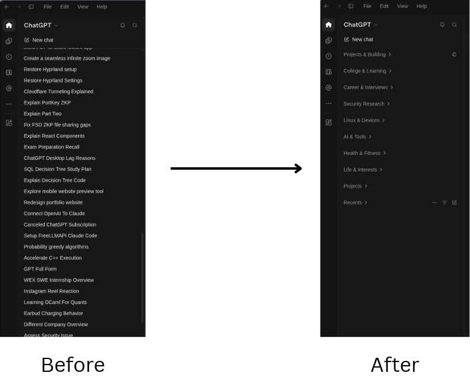

# OCD — Organized Chat Directory

A skill that organizes chats into topic groups, preserves manual placements, and supports undo. Works with Claude Code, Codex, and other apps that can load Agent Skills and run Python.

## Before and after



## Installation

Requires Python 3.10 or later. No Python dependencies or separate API keys are needed.

Clone or download this repository, open a terminal in its directory, and run the command for your app:

```sh
# Claude Code
python3 install.py --app claude

# Codex
python3 install.py --app codex

# Other apps: specify their skill directory
python3 install.py --target /path/to/app/skills/ocd
```

Start a new session if the skill does not appear.

## Usage

Invoke `/ocd` in Claude Code or `$ocd` in Codex, then ask to:

- Preview topic groups for your chats.
- Organize your chats.
- Undo the last organization.

Automatic sidebar changes require the target app's chat-reading and grouping tools. Without them, OCD can organize an exported chat list into a proposed layout. See [integration instructions](skill/ocd/references/integrations.md).

Pins, project membership, and manual placements are preserved. Empty or uncertain chats stay unassigned. Periodic maintenance must be scheduled separately through your app.

## Development

```sh
python3 -m unittest discover -s tests -v
```
