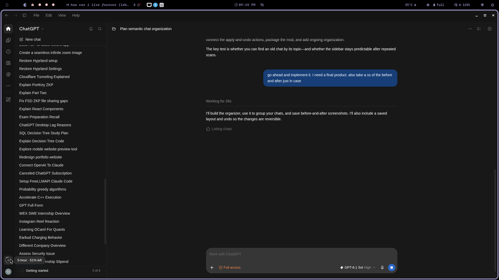
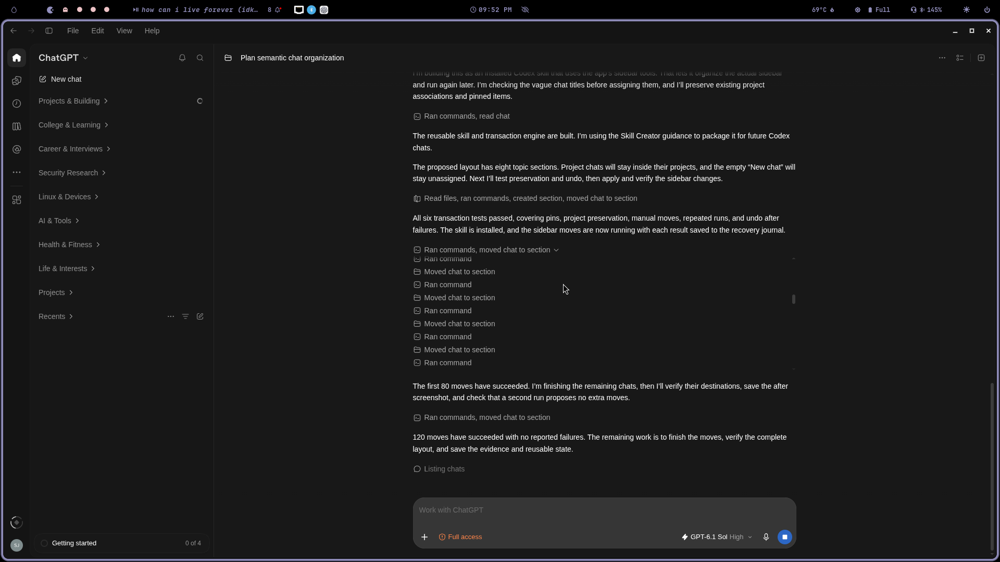

# Codex Chat Organizer

Organize your Codex and ChatGPT sidebar by topic instead of scrolling through a long list of unrelated chats.

Codex Chat Organizer is a **Codex skill** that groups chats and projects by meaning. It uses the desktop app's sidebar tools to apply changes, with saved snapshots and an undo journal.

## Before and after

These screenshots show the same sidebar before and after running the organizer.

| Before | After |
| --- | --- |
|  |  |

[View original before screenshot](docs/images/before.png) · [View original after screenshot](docs/images/after.png)

In this run, the organizer moved **143 standalone chats and 13 projects** into eight topic sections. Another 17 chats stayed inside their existing projects, and one empty chat stayed unassigned. All 156 placements were verified; a repeat run proposed no additional moves.

The section names in the screenshots belong to this particular collection. The skill chooses groups from your own chat history.

## Features

- **Topic-based grouping:** considers titles, summaries, project context, and selected messages when a title is unclear.
- **Preview:** see proposed moves before applying them.
- **Preserved placements:** leaves pins, existing custom sections, and project membership intact.
- **Manual overrides:** moving a managed chat yourself keeps later runs from moving it back.
- **Undo:** restores successful moves while preserving subsequent manual changes.
- **Repeatable runs:** reuses existing sections and skips already-correct placements.
- **Optional maintenance:** can be used with Codex scheduled tasks to organize new chats periodically.

## Requirements

- Codex desktop with tools for listing chats and managing sidebar sections.
- Python 3.10 or later.

The helper uses only the Python standard library. No separate API key or embedding service is required; Codex performs the classification within your session. Normal Codex usage limits still apply.

The installer and workflow have been tested on Linux. Other desktop platforms have not been verified. If the sidebar tools are unavailable in your Codex environment, the skill cannot apply changes.

## Installation

### 1. Get the repository

Clone this repository, or choose **Code → Download ZIP** on GitHub and extract it. Open a terminal in the repository's root directory, where `install.py` lives.

### 2. Install the skill

```sh
python3 install.py
```

The installer copies the skill to:

```text
~/.codex/skills/codex-chat-organizer/
```

Start a new Codex chat if the skill does not appear immediately.

### 3. Preview your groups

Send this in Codex:

```text
Use $codex-chat-organizer to preview how you would group my chats.
```

Then apply the organization:

```text
Use $codex-chat-organizer to organize my chats.
```

### Choose a data location

By default, new installations store snapshots, journals, and organizer state outside the repository:

```text
$XDG_DATA_HOME/codex-chat-organizer/
```

If `XDG_DATA_HOME` is unset, the location is `~/.local/share/codex-chat-organizer/`.

To choose a different directory:

```sh
python3 install.py --data-dir /path/to/private/organizer-data
```

The installed skill records this path in `data-location.txt`. Reinstalling preserves an existing data location unless you explicitly pass `--data-dir`. Changing the path does not migrate previous snapshots.

## Usage

| Task | Prompt |
| --- | --- |
| Preview | `Use $codex-chat-organizer to preview my chat groups.` |
| Organize | `Use $codex-chat-organizer to organize my chats.` |
| Undo | `Use $codex-chat-organizer to undo the last organization.` |

Empty chats and low-confidence assignments stay unassigned. Archived chats are excluded unless you ask to include them. The organizer changes sidebar placement; it does not rename, delete, or archive chats, change project membership, or change working directories.

### Automatic maintenance

Ask Codex to schedule a recurring run, for example:

```text
Use $codex-chat-organizer every hour to organize new chats.
Preserve my manual placements and only notify me if something needs attention.
```

Installation does not create a scheduled task. Maintenance is periodic and depends on Codex and its sidebar tools being available.

### Undo

Undo uses the saved journal for the requested run, or the most recent run by default. It restores only successful moves whose items are still in their organizer destination. Later manual moves are left alone.

Keep the data directory if you want to retain your recovery history.

## How it works

1. **Collect:** list active chats and projects and save the existing layout.
2. **Classify:** infer topics from chat context, reading selected messages when needed.
3. **Plan:** validate assignments and skip protected or uncertain placements.
4. **Apply:** move items through the app tools and journal each result.
5. **Verify:** check the resulting sidebar and save state for future runs.

Codex handles classification and app actions. The Python helper handles move plans, stale-placement checks, result journals, and undo operations. Running the helper by itself does not organize your sidebar.

The desktop can expose temporary client IDs for active chats. The helper resolves these from a snapshot alias map, with a read-only fallback to local app state. It does not write to Codex's databases or global state.

See [SKILL.md](skill/codex-chat-organizer/SKILL.md) for the workflow and JSON formats.

## Repository layout

```text
.github/workflows/tests.yml       Test workflow
README.md                         Installation and usage
install.py                        Skill installer
docs/images/                      Before-and-after screenshots
skill/codex-chat-organizer/
  SKILL.md                        Codex workflow
  agents/openai.yaml              Skill metadata
  scripts/organizer.py             Planning and undo helper
tests/                            Unit tests
```

## Development

Run the tests from the repository root:

```sh
python3 -m unittest discover -s tests -v
```

The suite covers pins, project preservation, manual moves, stale plans, repeated runs, failed operations, undo, temporary IDs, and installation behavior. GitHub Actions runs it on Python 3.10 and 3.13.

Inspect the helper commands with:

```sh
python3 skill/codex-chat-organizer/scripts/organizer.py --help
```

The available commands are `plan`, `resolve`, `record`, and `undo`.

## Local data and screenshots

Snapshots and journals contain private chat information. The repository's `.gitignore` excludes local `data/`, `evidence/`, data-location pointers, environment files, and Python caches.

The two screenshots under `docs/images/` are intentionally included so the before-and-after proof renders on GitHub. Original local captures remain in the ignored `evidence/` directory.

## Updating and uninstalling

After downloading a newer version, run `python3 install.py` again to update the installed skill.

To uninstall, remove `~/.codex/skills/codex-chat-organizer/`. Undo any sidebar changes and disable any scheduled maintenance separately if you no longer want them. Removing the skill does not restore the previous layout or erase your saved history.
